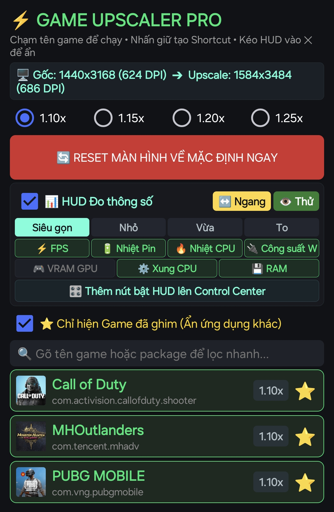

# ⚡ GameUpscaler Pro

[🇺🇸 English](#-english) • [🇻🇳 Tiếng Việt](#-tiếng-việt)

| Main UI / Giao diện chính | In-Game HUD / Thanh đo trong Game | Quick Tile / Control Center |
| :---: | :---: | :---: |
|  |  |  |

---

## 🇺🇸 English

**100% Free & Open-Source (No ads, no paywalls, no root required)** Android utility to sharpen game graphics (**1.10x – 1.25x**) and display a lightweight real-time **Hardware Telemetry HUD** (FPS, Wattage, Temperatures, VRAM) via **Shizuku**. Works on **Android 8.0 – 17** across all devices.

### ✨ Features
- **100% Free Forever:** Zero ads, zero subscriptions, completely open-source.
- **Game Resolution Upscaler (1.10x – 1.25x):** Sharpens 3D rendering and reduces jagged edges while preserving touch accuracy. Automatically restores native resolution when you exit the game.
- **Per-Game Profiles & Shortcuts:** Pin favorite games (`⭐`), set custom scale factors per game, and long-press any game to create a one-tap Home Screen shortcut.
- **Real-Time Hardware HUD (12 Metrics):** Live **FPS (`xx.x`)**, **Power Draw (W)**, **GPU VRAM**, **CPU Clock**, and **Temperatures** (Battery, SoC, CPU, GPU, DDR, Camera, Board).
- **Flexible Customization & Quick Tile:** Toggle individual metrics, switch 4 HUD sizes, horizontal/vertical layout, drag to `✕` to hide, or toggle anytime from Quick Settings (`FPS HUD`).

### 🛠️ Setup & Download
1. Install and activate **[Shizuku](https://github.com/RikkaApps/Shizuku)** on your Android device.
2. Download the latest `app-debug.apk` for free from **Releases** (or fork this repo ➔ open **Actions** ➔ run **Build APK**).
3. Open **GameUpscaler Pro** and grant **Display over other apps** permission.

### 🌍 Translate to Your Language (For Contributors)
All UI texts are isolated in XML resource files—no Kotlin code edits needed:
1. Copy `app/src/main/res/values/strings.xml` to `app/src/main/res/values-<lang>/strings.xml` (e.g., `values-ru`, `values-zh-rCN`, `values-es`).
2. Translate the strings inside `<string name="...">...</string>` and build the APK.

---

## 🇻🇳 Tiếng Việt

Ứng dụng **miễn phí 100% (không tốn tiền, không quảng cáo, không cần Root)** giúp tăng độ nét game (**1.10x – 1.25x**) và hiển thị thanh đo thông số phần cứng thời gian thực (**FPS, công suất điện, nhiệt độ, VRAM**) qua **Shizuku**. Hỗ trợ **Android 8.0 – 17** trên mọi dòng máy.

### ✨ Tính năng chính
- **Miễn phí trọn đời:** Không thu phí, không quảng cáo, mã nguồn mở hoàn toàn.
- **Tăng độ nét game (1.10x – 1.25x):** Làm nét hình ảnh và giảm răng cưa mà vẫn giữ nguyên tỷ lệ cảm ứng. Tự động trả màn hình về gốc ngay khi thoát game.
- **Quản lý game tiện lợi:** Ghim game hay chơi (`⭐`), đặt riêng mức độ nét cho từng game, nhấn giữ để tạo lối tắt mở nhanh ngoài màn hình chính.
- **Thanh đo phần cứng (12 thông số):** Theo dõi trực tiếp **FPS (`xx.x`)**, **công suất điện (W)**, **VRAM**, **xung CPU** và **nhiệt độ** (Pin, SoC, CPU, GPU, DDR, Camera, vỏ máy).
- **Tùy chỉnh linh hoạt & Control Center:** Bật/tắt từng thông số, đổi 4 cỡ chữ, xếp ngang hoặc dọc, kéo vào dấu `✕` để ẩn, hoặc bật nhanh qua nút **HUD Đo FPS** trên thanh trạng thái.

### 🛠️ Cài đặt & Tải APK
1. Cài đặt và kích hoạt **[Shizuku](https://github.com/RikkaApps/Shizuku)** trên điện thoại.
2. Tải file `app-debug.apk` miễn phí ở mục **Releases** (hoặc Fork repo ➔ vào tab **Actions** ➔ chạy **Build APK**).
3. Mở app và cấp quyền **Hiển thị trên ứng dụng khác** *(trên máy iQOO / Vivo nên cho phép Shizuku chạy nền không giới hạn để tránh bị ngắt giữa trận)*.

### 🌍 Hướng dẫn dịch sang ngôn ngữ khác
Toàn bộ chữ giao diện đã tách riêng ra file XML, ai muốn dịch thêm tiếng nước khác chỉ cần làm 2 bước:
1. Nhân bản file `app/src/main/res/values/strings.xml` sang thư mục `app/src/main/res/values-<mã-ngôn-ngữ>/strings.xml` (ví dụ: `values-ja`, `values-ko`, `values-ru`...).
2. Dịch nội dung bên trong các thẻ `<string>` rồi build lại APK là xong.

---

## 📜 License

MIT License