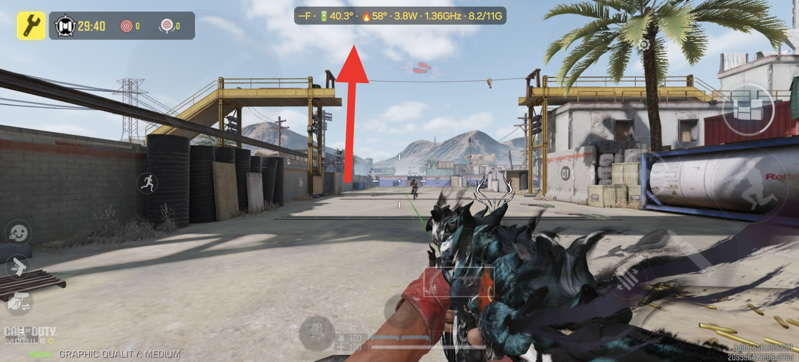

# ⚡ GameUpscaler Pro (Shizuku SSAA & Hardware HUD)

Ứng dụng Android siêu nhẹ giúp kích hoạt khử răng cưa **SSAA (Supersampling Anti-Aliasing)** ở tầng hệ thống và hiển thị bảng theo dõi phần cứng thời gian thực (**HUD Telemetry**) cho các tựa game (Call of Duty: Mobile, PUBG Mobile, Genshin Impact,...) thông qua quyền **Shizuku** mà **không cần Root máy**.

Được tối ưu hóa chuyên sâu cho **Android 14 – 17** và các dòng máy **iQOO / Vivo (OriginOS)**.

---

## 📸 Hình ảnh thực tế

> Đặt ảnh chụp màn hình vào thư mục `screenshots/` với đúng tên file bên dưới để tự động hiển thị trên trang chủ GitHub:

| Giao diện chính & Cấu hình | HUD đo thông số trong Game | Phím tắt Control Center |
| :---: | :---: | :---: |
|  |  |  |

---

## 🎯 Nguyên lý hoạt động

Trên các thiết bị màn hình độ phân giải cao (1.5K / 2K Ultra HD), nhiều tựa game tự động giới hạn độ phân giải dựng hình nội bộ (Internal Render Resolution) xuống mức 720p/1080p rồi kéo giãn lên tấm nền vật lý, gây ra hiện tượng mờ nhòe và răng cưa nặng ở vật thể xa.

**GameUpscaler Pro** khắc phục triệt để bằng cách:
1. Đọc trực tiếp thông số vật lý (`Physical size` và `Physical density`) thực tế của màn hình.
2. Nâng khung hình dựng (`wm size`) và mật độ điểm ảnh (`wm density`) theo các mốc an toàn (**1.10x – 1.15x – 1.20x – 1.25x**), buộc engine game render ở độ phân giải cao hơn thực tế (SSAA) mà vẫn giữ nguyên tỷ lệ giao diện hệ thống.
3. Giữ ngưỡng trần **1.25x** (dưới giới hạn 4000px chiều dài trên màn hình 2K) để đảm bảo IC cảm ứng (`InputDispatcher`) trên OriginOS nhận diện tọa độ chính xác 100%, không lệch tâm bắn.
4. Theo dõi tiến trình game ở nền (`pidof`) và **tự động Reset màn hình về mặc định** sau 3 giây khi thoát game.

---

## ✨ Tính năng chính

### 1. Tùy chỉnh độ phân giải & Quản lý Game thông minh
- **4 mức SSAA linh hoạt:**
  - `1.10x` (Siêu nhẹ): Tăng độ nét nhẹ, tiết kiệm pin tối đa khi chơi ngoài trời.
  - `1.15x` (Mát): Khử răng cưa tốt, giữ nhiệt độ ổn định.
  - `1.20x` (Vừa): Cân bằng giữa độ sắc nét và hiệu năng.
  - `1.25x` (Chuẩn): Độ nét tối đa, triệt tiêu răng cưa tầm xa.
- **Xem trước thông số thực tế:** Hiển thị trực tiếp độ phân giải và DPI gốc so với thông số sau khi Upscale ngay trên màn hình chính.
- **Cấu hình riêng từng Game (Per-Game Profile):** Bấm vào thẻ tỷ lệ trên từng dòng game để khóa cố định mức scale riêng cho từng trò (ví dụ: CODM khóa `1.25x`, PUBG khóa `1.15x`).
- **Ghim & Lọc game yêu thích:** Tự động ghim CODM và PUBG lên đầu; bấm `⭐` để ghim thêm bất kỳ app nào và bật chế độ **Chỉ hiện Game đã ghim** để ẩn toàn bộ ứng dụng hệ thống.
- **Tạo Shortcut ngoài màn hình chính:** Nhấn giữ vào tên game để đẩy biểu tượng mở nhanh ra màn hình chính — chạm vào là tự kích SSAA ngầm và vào thẳng game.

### 2. Bảng đo phần cứng nổi (Real-Time Hardware HUD)
- **7 thông số thời gian thực** (tùy chọn bật/tắt độc lập từng món):
  - `⚡ FPS`: Đo tốc độ khung hình thực tế qua `SurfaceFlinger --timestats` (tương thích Android 17 BLASTBufferQueue).
  - `🔋 Nhiệt Pin`: Nhiệt độ thân máy/pin chính xác từng `0.1°C` qua `BatteryManager`.
  - `🔥 Nhiệt CPU`: Nhiệt độ cảm biến lõi SoC.
  - `🔌 Công suất W`: Công suất tiêu thụ điện năng tức thời (Watt) qua `BatteryManager` HAL.
  - `🎮 VRAM GPU`: Dung lượng bộ nhớ đồ họa GPU tiến trình game đang chiếm dụng qua `dumpsys gpu`.
  - `⚙️ Xung CPU`: Xung nhịp cao nhất hiện tại của nhân CPU (`GHz`/`MHz`).
  - `💾 RAM`: Dung lượng RAM tiến trình game đang sử dụng.
- **Tùy biến giao diện HUD:**
  - **4 kích thước:** `Siêu gọn` • `Nhỏ` • `Vừa` • `To` (có thể chạm nhẹ trực tiếp vào thanh HUD khi đang chơi để đổi cỡ nóng).
  - **2 kiểu hiển thị:** Xếp **Ngang (`↔️`)** hoặc xếp **Dọc (`↕️`)** sát mép màn hình.
  - **Tách biệt tọa độ Dọc & Ngang:** Tự động ghi nhớ vị trí riêng cho màn hình dọc và màn hình ngang (mặc định màn ngang luôn nằm sát mép trên cùng để tránh chạm nhầm thanh điều hướng/đa nhiệm).
  - **Kéo thả vào vùng `✕` để ẩn nhanh:** Kéo thanh HUD chạm vào vòng tròn đỏ `✕` ở cạnh dưới màn hình để tắt bảng đo ngay lập tức mà không làm gián đoạn tiến trình tự Reset độ phân giải.

### 3. Phím tắt Control Center & Tối ưu hiệu năng
- **Bật/tắt 1 chạm từ Control Center (Quick Settings Tile):** Tích hợp nút **HUD Đo FPS** trên thanh trạng thái/Control Center của OriginOS, cho phép bật hoặc tắt nhanh bảng đo phần cứng ở bất kỳ đâu mà không cần mở lại app.
- **Persistent Shizuku Shell Stream:** Duy trì một phiên shell duy nhất và gộp toàn bộ truy vấn cảm biến vào 1 lượt đọc mỗi giây, giảm tối đa chi phí tạo tiến trình nền và độ trễ hệ thống.
- **Khôi phục đa lớp & Cài đè tiện lợi:** Tự Reset khi đóng game, nút **Reset Khẩn Cấp** màu đỏ trong app, hoặc chạm trực tiếp vào thanh thông báo đang chạy; sử dụng chữ ký số cố định (`upscaler.jks`) cho phép cài đè trực tiếp không cần gỡ bản cũ.

---

## 🛠️ Yêu cầu & Cấp quyền lần đầu

1. **Android 8.0 trở lên** (Đã tối ưu cho **Android 14 – 17 / OriginOS**).
2. Cài đặt và kích hoạt **[Shizuku](https://github.com/RikkaApps/Shizuku)** qua Gỡ lỗi không dây (Wireless Debugging).
3. **Lưu ý cho người dùng iQOO / Vivo (OriginOS):**
   - Trong *Cài đặt -> Pin*, cho phép **Shizuku** chạy nền không giới hạn để tránh bị hệ thống ngắt kết nối giữa trận.
   - Trong *Cài đặt -> Ứng dụng -> iQOO Upscaler -> Quyền*, bật **Hiển thị trên ứng dụng khác**, **Hiển thị cửa sổ pop-up khi chạy ở nền** (để hiện HUD đo FPS) và **Lối tắt trên màn hình chính** (để tạo Shortcut game).

---

## 🔨 Tự động Build APK qua GitHub Actions

Dự án tích hợp sẵn workflow tự động biên dịch và xuất bản file APK:
1. Fork repository này về tài khoản GitHub của bạn.
2. Vào tab **Actions** -> Chọn **Build APK** -> Bấm **Run workflow**.
3. Sau khoảng 1–2 phút, tải file `app-debug.apk` mới nhất tại mục **Releases**.

---

## 📜 Giấy phép (License)

Phát hành dưới giấy phép MIT License.