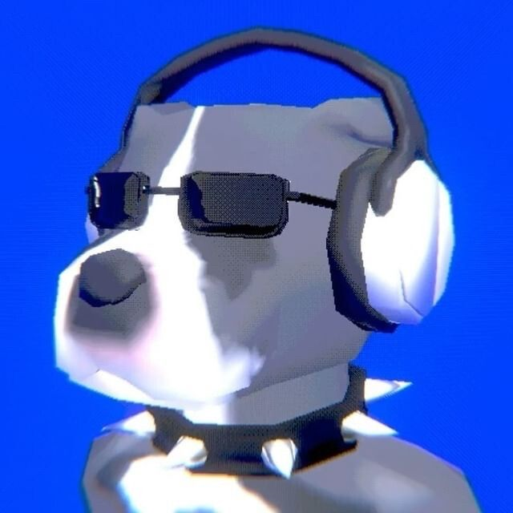
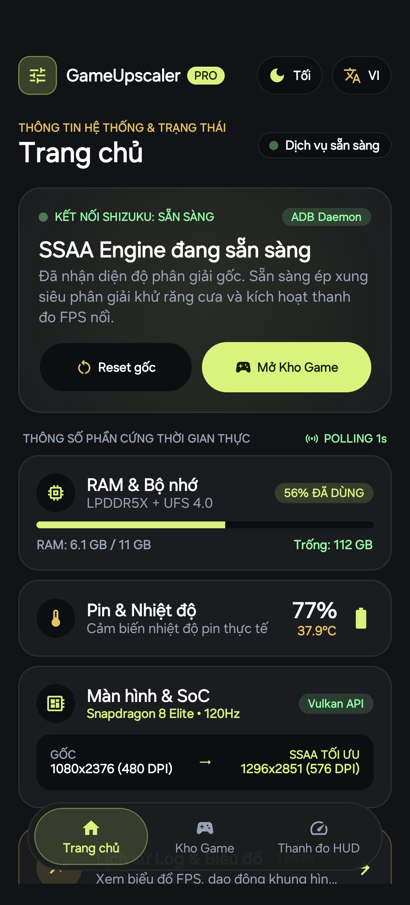
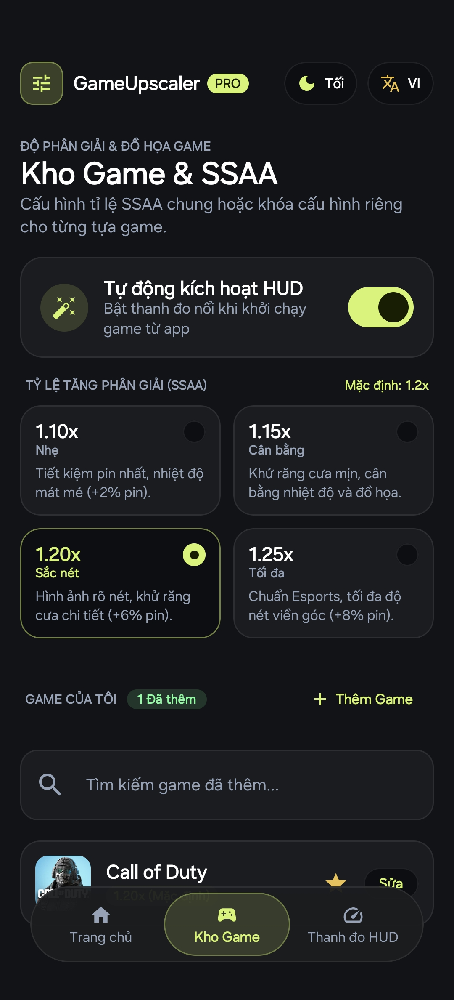
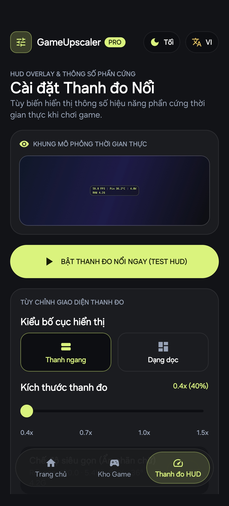
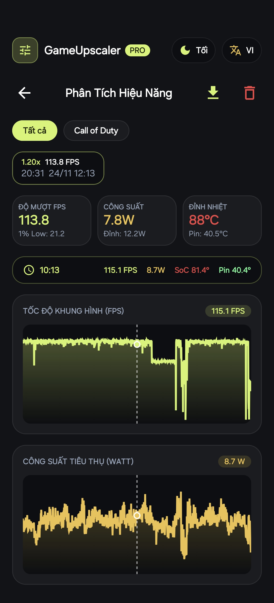
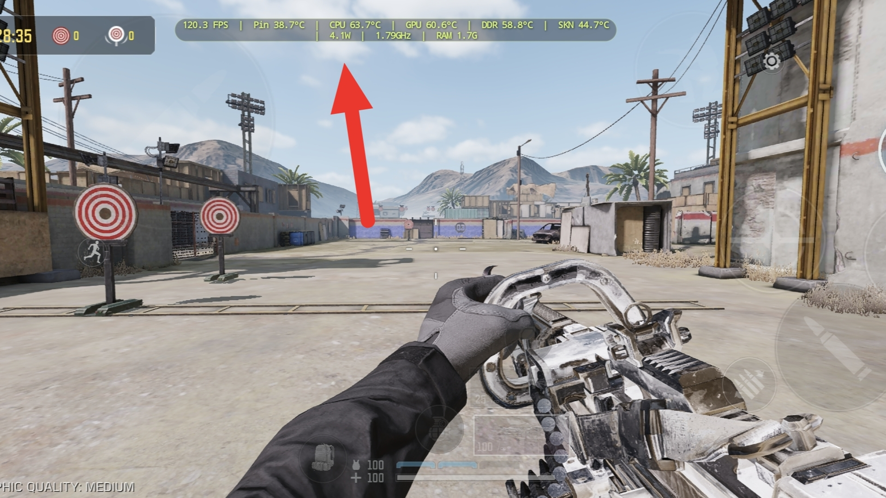
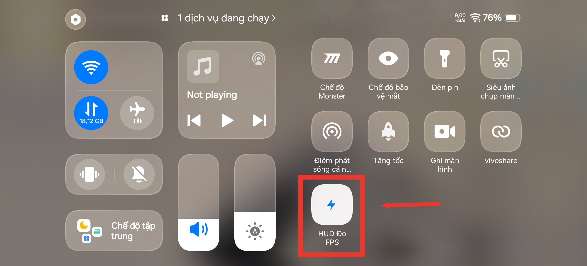

# ⚡ GameUpscaler Pro

  

  <b>Tăng độ nét game (SSAA 1.10x – 1.25x) & Thanh đo thông số phần cứng thời gian thực (FPS, Watt, Nhiệt độ, GPU Load) qua Shizuku</b> 
  <i>Giao diện Jetpack Compose (Material 3) • Hoàn toàn miễn phí • Mã nguồn mở 100% • Không cần Root • Không quảng cáo</i>

  
  
  
  
  

---

## 📸 Ảnh chụp giao diện thực tế (Screenshots)

| 📊 Trang chủ | ⚡ Kho game & SSAA | 🎛️ Cấu hình HUD | 📈 Biểu đồ Log |
| :---: | :---: | :---: | :---: |
|  |  |  |  |

| 🎮 Thanh đo HUD ingame | 📲 Phím tắt Control Center |
| :---: | :---: |
|  |  |

---

## 🇻🇳 Tiếng Việt

**GameUpscaler Pro** là công cụ tối ưu hóa trải nghiệm chơi game chuyên nghiệp trên Android. Ứng dụng tích hợp công nghệ **Super-Sampling Anti-Aliasing (SSAA)** can thiệp qua **Shizuku API** để nâng độ phân giải render ảo (1.10x – 1.25x), giúp hình ảnh trong game mịn màng, triệt tiêu viền răng cưa 3D mà vẫn giữ nguyên tỉ lệ cảm ứng chính xác 100%.

Bên cạnh đó, ứng dụng trang bị **Thanh đo phần cứng nổi (Floating HUD Telemetry)** thời gian thực và hệ thống **Biểu đồ ghi log hiệu năng (Performance Analytics)** chuẩn xác, không làm tụt xung hay ảnh hưởng hiệu năng chơi game.

### 🌟 Điểm nổi bật ở phiên bản mới

- **Giao diện Jetpack Compose (Material 3)**: Hiện đại, mượt mà, hỗ trợ chuyển đổi Light/Dark mode đồng bộ, đa ngôn ngữ (Tiếng Việt & English).
- **Tăng độ nét SSAA tự động**: Tự nhận diện game, áp tỷ lệ tăng nét theo từng game và tự động khôi phục độ phân giải gốc ngay khi đóng game.
- **Thanh đo HUD phân tầng (Layered Telemetry)**:
  - **Nhịp nhanh (150ms – 300ms)**: FPS SurfaceFlinger & DRM node (chính xác 0.1), Công suất xả/sạc pin tức thời (Watt), Mức tải GPU thực tế qua node sysfs (`/sys/class/kgsl/...`).
  - **Nhịp 1 giây (1000ms)**: Đồng bộ nhiệt độ từ các cụm cảm biến SoC, CPU (nhân Prime, Titanium, Gold, Oryon...), GPU, Pin, RAM DDR, Camera, Vỏ máy (Skin).
  - **Nhịp 3 giây (3000ms)**: Bộ nhớ VRAM đồ họa (`dumpsys gpu`), RAM hệ thống và dò tự động game đang hiển thị.
- **Tùy biến hiển thị thông minh**:
  - Dạng ngang tự động bung 1 dòng trên màn hình xoay ngang (Landscape), tự động xuống dòng đều lề trái ở màn hình dọc (Portrait).
  - Hỗ trợ Display Cutout (Short Edges) tràn viền không bị giới hạn camera nốt ruồi / tai thỏ.
  - Tùy chỉnh tỷ lệ kích thước (Scale), độ mờ nền kính (Glassmorphism), cảnh báo màu theo ngưỡng nhiệt.
- **Phím tắt Control Center (Quick Settings Tile)**: Bật/tắt thanh đo HUD nhanh từ thanh cài đặt nhanh của Android mà không cần mở ứng dụng.
- **Ghi log & Biểu đồ hiệu năng**: Chạm nút ● REC trên HUD để lưu lại thông số cả trận, hiển thị biểu đồ FPS, 1% Low, mức tiêu thụ điện năng (mWh).

---

### 📱 Các màn hình chính trong ứng dụng

1. **📊 Trang chủ (System Monitor)**:
   - Trạng thái kết nối Shizuku và độ phân giải / mật độ điểm ảnh (density) màn hình gốc.
   - Dung lượng RAM đang dùng và RAM khả dụng.
   - Trạng thái Pin, mức tiêu thụ điện năng tức thời (Watt), nhiệt độ Pin và nhiệt độ SoC.
   - Nút **Khôi phục màn hình gốc (Reset)** tức thì bất cứ lúc nào.
   - Danh sách game đã ghim để mở nhanh.

2. **⚡ Kho Game & Khử răng cưa (SSAA Upscaler)**:
   - Cài đặt tỷ lệ khử răng cưa mặc định:
     - **1.10x**: Mát máy, nhẹ nhàng, siêu tiết kiệm pin.
     - **1.15x (Khuyên dùng)**: Cân bằng lý tưởng giữa độ nét đồ họa và FPS mượt mà.
     - **1.20x**: Hình ảnh sắc nét cao cho các dòng máy tầm trung khá trở lên.
     - **1.25x**: Khử răng cưa tối đa cho các dòng máy Flagship.
   - Quản lý danh sách game, tìm kiếm, ghim yêu thích (`⭐`), cấu hình tỷ lệ riêng cho từng game.
   - Khởi chạy game với SSAA và tự động hoàn tác về màn hình gốc khi thoát game.

3. **🎛️ Thanh trạng thái (HUD Overlay Settings)**:
   - Live Preview giả lập hiển thị thực tế theo từng tùy chỉnh.
   - Chọn Preset bố cục: **Ngang**, **Cột dọc**, **Mini Dot**.
   - Điều chỉnh độ mờ nền kính (Đậm, Kính mờ, Trong suốt, Chỉ chữ).
   - Thanh trượt kích thước HUD (Scale) & công tắc ẩn nhãn (chỉ hiện số siêu gọn).
   - Bật/tắt tự do 13 loại thông số phần cứng theo nhu cầu.

4. **📈 Phân tích hiệu năng (Performance Analytics)**:
   - Danh sách các phiên ghi nhận hiệu năng (Session logs).
   - Biểu đồ thời gian thực: FPS, Công suất (W), Nhiệt độ Pin & SoC, Mức tải GPU/VRAM.
   - Đo lường chỉ số chuẩn eSports: FPS trung bình, FPS tối đa/tối thiểu, 1% Low FPS.

---

### 🚀 Hướng dẫn cài đặt & Kích hoạt Shizuku

1. Cài đặt app **[Shizuku](https://shizuku.rikka.app)** từ Google Play hoặc GitHub.
2. Mở Shizuku và kích hoạt qua **Ghép nối không dây (Wireless Debugging)** hoặc cắm máy tính chạy lệnh ADB (không cần Root).
   > 💡 *Lưu ý cho Xiaomi/HyperOS, Vivo/iQOO, Oppo/Realme:* Hãy bật thêm mục **Gỡ lỗi không dây (Cài đặt bảo mật)** trong Tùy chọn nhà phát triển để Shizuku có quyền chỉnh kích thước màn hình.
3. Mở **GameUpscaler Pro**, cấp quyền **Hiển thị trên ứng dụng khác (Overlay)** để sử dụng thanh đo HUD.
4. Chọn mức SSAA mong muốn (khuyên dùng `1.15x`), chọn game và bắt đầu trải nghiệm!

---

## 🇺🇸 English

**GameUpscaler Pro** is a modern, open-source Android optimization tool built with **Jetpack Compose (Material 3)**. It harnesses **Super-Sampling Anti-Aliasing (SSAA)** through **Shizuku API** to render 3D games at higher internal resolutions (1.10x – 1.25x), eliminating jagged edges while perfectly preserving native touch mapping.

In addition, it features an advanced in-game **Hardware Telemetry Floating HUD** and full **Performance Analytics** with interactive charts.

### ✨ Key Features

- **100% Free & Open Source**: No ads, no analytics trackers, no root required.
- **Full Material 3 Jetpack Compose UI**: Seamless Light/Dark theme switching, multi-language support (Vietnamese & English).
- **SSAA Resolution Upscaler**:
  - 4 presets (1.10x, 1.15x Recommended, 1.20x, 1.25x) or custom scaling.
  - Automatically reverts to native screen dimensions upon exiting the game.
  - Per-game custom profiles and game library manager.
- **Layered Hardware Telemetry HUD**:
  - **Fast Polling (150ms – 300ms)**: Real-time 0.1 precise FPS (SurfaceFlinger & DRM node), instant power wattage (W), real GPU core utilization via sysfs.
  - **1s Cadence (1000ms)**: Temperature tracking across CPU cores (including Prime/Titanium/Gold/Oryon clusters), GPU, SoC, Battery, DDR, Camera, and Skin.
  - **3s Cadence (3000ms)**: VRAM buffer, system RAM usage, and foreground app tracking.
- **Adaptive Layout Engine**:
  - Single-line horizontal layout in Landscape mode; neat left-aligned multi-row wrap in Portrait mode.
  - Cutout short edges support ensuring edge-to-edge drawing across camera punch-holes.
- **Control Center Quick Settings Tile**: One-tap toggle for the HUD directly from Android's status bar.
- **In-Game Session Recorder & Charting**: Tap ● REC on HUD to log gameplay telemetry and view FPS stability curves, 1% Low FPS, and energy metrics.

---

### 📥 Download & Installation

1. Grab the latest APK from the **[Releases](https://github.com/hoanfnho7/GameUpscaler/releases)** page.
2. Ensure **[Shizuku](https://shizuku.rikka.app)** is running on your device (via Wireless Debugging or ADB).
3. Grant **Draw over other apps** (Overlay permission) when prompted.
4. Launch your game via GameUpscaler Pro with your preferred SSAA factor!

---

## 📜 License

Distributed under the [MIT License](LICENSE).
