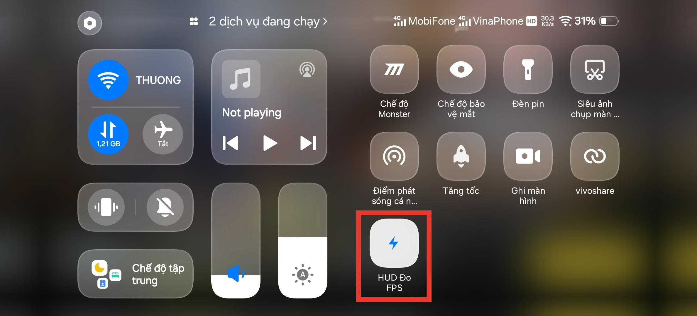

# ⚡ GameUpscaler Pro

**100% Free & Open-Source (No ads, no paywalls, no root required)** Android utility to boost game sharpness (**1.10x – 1.25x SSAA**) and display a lightweight real-time **Hardware Telemetry HUD** (FPS, Power Wattage, Temperatures, VRAM) via **Shizuku**. Compatible with **Android 8.0 – 17** across all devices (Samsung, Xiaomi, OnePlus, Pixel, iQOO / Vivo, etc.).

*(Ứng dụng **miễn phí 100% — không quảng cáo, không thu phí** giúp tăng độ nét game và đo thông số phần cứng thời gian thực qua Shizuku, hỗ trợ mọi dòng máy Android không cần Root).*

---

## 📸 Screenshots / Hình ảnh thực tế

| Main UI / Giao diện chính | In-Game HUD / Thanh đo trong Game | Quick Tile / Phím tắt Control Center |
| :---: | :---: | :---: |
|  |  |  |

---

## ✨ Features / Tính năng chính

- **100% Free Forever / Miễn phí trọn đời:** Zero ads, zero subscriptions, fully open-source alternative to paid performance monitors.
- **Game Resolution Upscaler (1.10x – 1.25x):** Sharpens 3D rendering and reduces jagged edges while preserving touch accuracy. Automatically restores native resolution when you exit the game.
- **Per-Game Profiles & Shortcuts:** Pin favorite games (`⭐`), set custom scale factors per game, and long-press any game to create a one-tap Home Screen shortcut.
- **Real-Time Hardware HUD (12 Metrics):** Live **FPS (`xx.x`)**, **Power Draw (W)**, **GPU VRAM**, **CPU Clock**, and **Temperatures** (Battery, SoC, CPU, GPU, DDR, Camera, Board).
- **Bilingual UI (English / Tiếng Việt):** Automatically matches your phone's language or switches on-the-fly with one tap (`🌐 Auto` / `🇻🇳 VI` / `🇺🇸 EN`).
- **Quick Settings Tile:** Toggle the floating HUD anytime directly from your Control Center / Notification Shade.

---

## 🛠️ Setup / Cài đặt

1. Install and activate **[Shizuku](https://github.com/RikkaApps/Shizuku)** on your Android device.
2. Open **GameUpscaler Pro** and grant **Display over other apps** permission.
3. *(Optional)* Allow unrestricted background battery usage for **Shizuku** so the connection stays active during long gaming sessions.

---

## 🔨 Download / Build APK

- Download the latest `app-debug.apk` for free from the **Releases** section on the right.
- Or fork this repository ➔ open **Actions** ➔ run **Build APK** to compile your own signed APK.

---

## 📜 License

MIT License